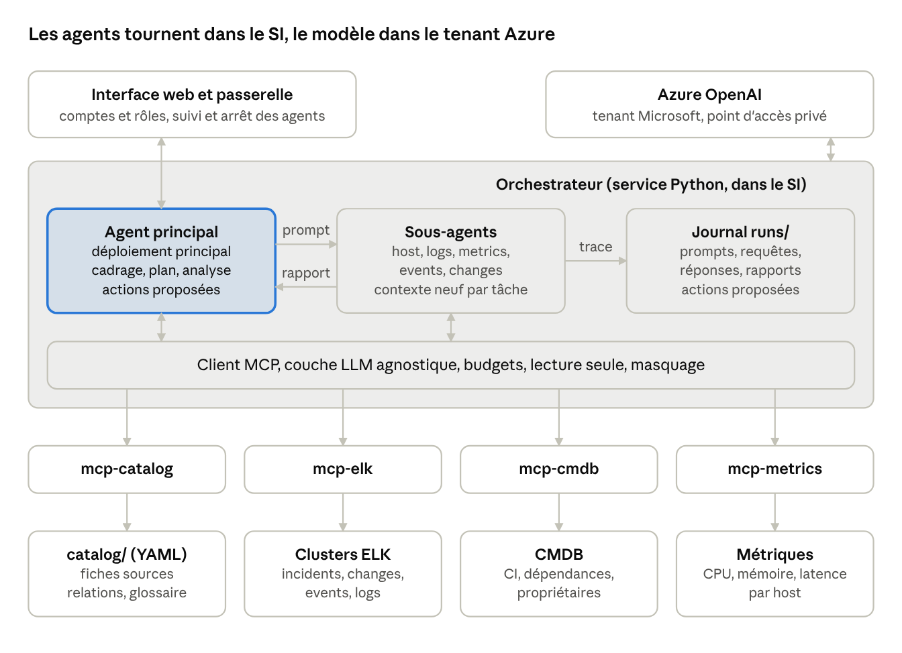
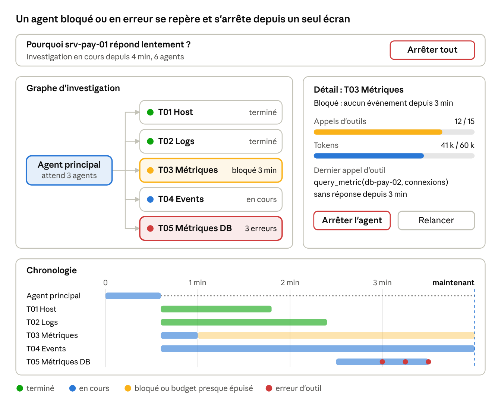

# Architecture de l'agent IA de diagnostic de production

7 octobre 2026 · Erik

> Version de référence éditable : [Claude Doc](https://claude.ai/code/artifact/870f5346-1d59-4188-a73e-dca1913ca8f9). Ce fichier en est l'export Markdown.

## Contexte et objectifs

L'agent répond en langage naturel à des questions sur la production, de la plus simple (« quels incidents ouverts sur srv-pay-01 ? ») à la plus complexe (« pourquoi le service paiement est-il dégradé depuis hier soir ? »). Il décompose la question, interroge toutes les sources utiles, consolide une analyse et propose des actions, sans jamais les exécuter dans cette première version.

**Objectifs**

1. Rendre chaque source de données (clusters ELK, index incidents, changes, events, CMDB, métriques) découvrable par l'agent grâce à un catalogue déclaratif, extensible sans toucher au code.
2. Décomposer une question en investigations indépendantes confiées à des sous-agents spécialisés, lancés avec un prompt généré par l'agent principal.
3. Produire une analyse argumentée : faits sourcés, hypothèses, cause probable, niveau de confiance.
4. Proposer des actions de remédiation, décrites et justifiées, mais non exécutées.
5. Tracer chaque prompt, requête, réponse et résultat dans des fichiers lisibles par un humain et par un agent.
6. Rester indépendant du fournisseur de modèle : changer de LLM (Claude, modèle interne, autre API) sans toucher à la logique d'agent.
7. Offrir une interface web pour dialoguer avec l'agent principal, suivre graphiquement les agents en cours et arrêter un agent.
8. Authentifier chaque utilisateur et limiter ses fonctions selon son rôle.

**Hors périmètre de la V1** : exécution d'actions, écriture dans les outils ITSM, déclenchement automatique sur alerte.

**Hypothèses retenues** (à confirmer)

- Les données restent dans le SI : l'orchestrateur, l'interface web et les serveurs MCP tournent on-premise ou dans le cloud privé ; le modèle LLM est consommé via Azure OpenAI, dans le tenant Microsoft de l'entreprise, considéré comme faisant partie du SI ; aucun autre fournisseur externe.
- Les sources ELK sont accessibles en lecture via un compte technique dédié à l'agent.
- Le langage d'implémentation est Python pour l'orchestrateur et les serveurs MCP (SDK `openai` pour Azure OpenAI, SDK MCP Python).
- Un utilisateur pose une question à la fois ; la parallélisation se fait à l'intérieur d'une investigation.

* L'interface web est écrite en TypeScript et parle à l'orchestrateur par une API HTTP et un flux temps réel.
* L'authentification s'appuie d'abord sur une table d'utilisateurs interne ; le branchement sur l'annuaire d'entreprise (OpenID Connect) est prévu en industrialisation.

## Vue d'ensemble

L'architecture tient en quatre couches : une interface web authentifiée pour dialoguer et piloter, un orchestrateur qui fait tourner l'agent principal et ses sous-agents, des serveurs MCP en lecture seule devant chaque famille de sources, et un journal en fichiers qui garde toute la trace.



L'agent principal envoie un prompt à chaque sous-agent et reçoit un rapport ; tous passent par le client MCP pour lire les sources et écrivent leur trace dans `runs/`.

## Catalogue de sources de données

Chaque source est décrite par un fichier YAML dans un dossier `catalog/` ; ajouter une source revient à déposer un fichier, sans redéploiement de code. Le catalogue sert à deux choses : dire à l'agent ce qu'il peut trouver et où, et dire aux serveurs MCP comment se connecter.

**Organisation du dossier**

```
catalog/
  clusters/            # un fichier par cluster ELK (connexion, version, auth)
    elk-prod-eu.yaml
    elk-prod-us.yaml
  sources/             # un fichier par source logique (index ou alias)
    incidents.yaml
    changes.yaml
    events.yaml
    cmdb.yaml
    logs-applicatifs.yaml
    metrics-hosts.yaml
  glossary.yaml        # vocabulaire métier, alias de services, codes applicatifs
  relations.yaml       # clés de jointure entre sources (host, CI, service)
```

Un cluster et une source sont séparés : la même source logique peut vivre sur plusieurs clusters (par région), et un cluster héberge plusieurs sources.

**Fiche source : champs obligatoires**

| Champ | Rôle pour l'agent | Exemple |
| --- | --- | --- |
| `id` | Nom stable utilisé dans les appels d'outils | `incidents` |
| `description` | Ce que contient la source et quand l'utiliser, en 2 à 4 phrases | « Tickets d'incident ITSM, un document par ticket et par mise à jour… » |
| `clusters` / `index` | Où chercher (alias ou pattern) | `elk-prod-eu`, `itsm-incidents-*` |
| `time_field` | Champ de date pour filtrer une période | `@timestamp` |
| `entity_keys` | Champs qui identifient un host, un CI, un service | `host.name`, `ci.id`, `service.code` |
| `fields` | Champs utiles avec type, sens et valeurs possibles | `priority: P1..P4` |
| `example_queries` | 2 à 5 requêtes types en DSL ou ES\|QL avec la question qu'elles résolvent | « incidents P1 d'un service sur 24 h » |
| `retention` / `freshness` | Profondeur d'historique et délai d'indexation | `90 jours`, `< 2 min` |
| `limits` | Taille max de réponse, champs à ne jamais remonter (données personnelles) | `max_hits: 200` |
| `owner` | Équipe responsable de la source | `équipe ITSM` |

**Exemple de fiche**

```yaml
id: incidents
description: >
  Tickets d'incident ITSM. Un document par ticket, mis à jour à chaque
  changement de statut. À utiliser pour savoir si un problème est déjà
  connu, son historique et sa résolution.
clusters: [elk-prod-eu]
index: itsm-incidents-*
time_field: opened_at
entity_keys:
  host: affected_ci.hostname
  ci: affected_ci.id
  service: business_service.code
fields:
  number:   {type: keyword, desc: "Numéro INCxxxxxxx"}
  priority: {type: keyword, values: [P1, P2, P3, P4]}
  state:    {type: keyword, values: [New, In Progress, Resolved, Closed]}
  short_description: {type: text}
example_queries:
  - question: "Incidents ouverts sur un host"
    esql: |
      FROM itsm-incidents-* | WHERE affected_ci.hostname == "{host}"
        AND state != "Closed" | SORT opened_at DESC | LIMIT 50
retention: 2 ans
freshness: 5 min
limits: {max_hits: 200, exclude_fields: [caller.email, caller.phone]}
owner: équipe ITSM
```

**Comment l'agent utilise le catalogue**

1. Le prompt système de l'agent principal contient un résumé court de chaque source (`id` + `description`), généré au démarrage. Ce bloc est stable, donc mis en cache.
2. Pour le détail (champs, exemples), l'agent appelle l'outil `describe_source(id)` : le contexte reste petit même avec 50 sources.
3. `relations.yaml` dit comment passer d'une source à l'autre (par exemple `cmdb.hostname` = `incidents.affected_ci.hostname` = `logs.host.name`), ce qui évite les jointures devinées.
4. Un script de validation (schéma JSON + requête de test sur chaque index) tourne en CI sur le dépôt du catalogue, pour qu'une fiche erronée ne soit jamais servie à l'agent.

Une fiche peut être amorcée automatiquement à partir du mapping ELK (`GET <index>/_mapping`) puis complétée par l'équipe propriétaire : la description et les exemples sont ce qui fait la qualité des recherches de l'agent.

**Gouvernance des fiches** (décision du 7 octobre 2026)

1. L'équipe de l'agent rédige la fiche, amorcée depuis le mapping ELK, et l'ouvre en demande de fusion sur le dépôt du catalogue.
2. L'équipe propriétaire de la source (champ `owner`) relit la description, les champs et les exemples, puis valide.
3. La CI vérifie le schéma et exécute les requêtes d'exemple ; la fiche n'est servie à l'agent qu'après fusion.
4. Une revue trimestrielle, ou un changement de mapping détecté sur l'index, déclenche une mise à jour par le même circuit.

## Couche tools et MCP

Toutes les sources sont exposées via des serveurs MCP internes, en lecture seule ; l'orchestrateur s'y connecte comme client MCP et présente leurs outils au modèle. Ce découplage permet d'ajouter une source ou un outil sans modifier l'agent.

**Serveurs MCP proposés**

| Serveur MCP | Outils exposés | Source |
| --- | --- | --- |
| `mcp-catalog` | `list_sources`, `describe_source(id)`, `resolve_entity(name)` | Dossier `catalog/` |
| `mcp-elk` | `search(source, query, time_range, size)`, `esql(source, query)`, `aggregate(source, field, time_range)`, `get_document(source, id)` | Tous les clusters ELK du catalogue |
| `mcp-cmdb` | `get_ci(id_or_hostname)`, `get_dependencies(ci, depth)`, `get_owners(ci)` | CMDB indexée dans ELK ; requêtes spécialisées (CI, dépendances, propriétaires) sur les mêmes clusters que mcp-elk |
| `mcp-metrics` | `query_metric(host, metric, time_range, step)`, `list_metrics(host)` | Plusieurs outils de métriques, un connecteur par outil |
| `mcp-workspace` | `write_note`, `read_artifact`, `list_artifacts` | Dossier de l'investigation en cours |

Un serveur `mcp-elk` générique, piloté par le catalogue, est préféré à un serveur par index : l'agent passe l'`id` de la source, le serveur résout cluster, index, champ de date et limites depuis la fiche.

Les métriques sont réparties entre plusieurs outils (décision du 7 octobre 2026). `mcp-metrics` présente donc une interface unique à l'agent et route chaque demande vers le bon outil :

- **Un connecteur par outil** (Elasticsearch, Prometheus, APM…) dans `mcp-metrics`, chacun traduisant la demande dans le langage de l'outil (requête ES, PromQL, API de l'APM).
- **Fiche catalogue par source de métriques** (`catalog/sources/metrics-<outil>.yaml`) : outil, périmètre couvert (hosts, applications, environnements), métriques disponibles, granularité, rétention.
- **Noms de métriques normalisés** dans `glossary.yaml` : l'agent demande `cpu.usage`, `mem.used_pct` ou `http.latency_p95`, et chaque connecteur connaît le nom natif correspondant.
- **Résolution du host** : `mcp-metrics` cherche dans quel outil un host est suivi (via la CMDB ou les fiches catalogue) ; si plusieurs outils le suivent, il interroge le plus précis et indique la source dans la réponse.
- **Réponse homogène** : série temporelle au même format quel que soit l'outil, plus un résumé (min, max, moyenne, ruptures détectées) pour ne pas envoyer de séries brutes au modèle.

**Règles communes à tous les outils**

- **Lecture seule** : le compte technique n'a que les droits `read` et `view_index_metadata` ; aucune API d'écriture n'est exposée.
- **Réponses bornées** : chaque outil plafonne le nombre de documents (200 par défaut) et tronque les champs longs. Au-delà, il renvoie un résumé (comptes, top valeurs) et écrit le résultat complet dans un fichier dont il retourne le chemin.
- **Période obligatoire** : toute recherche porte sur un intervalle explicite, par défaut les 24 dernières heures.
- **Erreurs explicites** : une erreur de syntaxe ou un timeout revient comme résultat d'outil en erreur avec le message ELK, pour que l'agent corrige sa requête.
- **Masquage** : les champs listés en `exclude_fields` sont retirés côté serveur, jamais côté modèle.
- **Journalisation** : chaque appel est écrit dans le dossier de l'investigation (voir la section Traçabilité).

**Outils d'orchestration** (internes à l'orchestrateur, pas MCP)

| Outil | Disponible pour | Rôle |
| --- | --- | --- |
| `spawn_subagent(role, objective, prompt, context_refs)` | Agent principal | Lance un sous-agent avec un prompt généré |
| `wait_subagents(ids)` | Agent principal | Attend et récupère les rapports |
| `submit_report(report)` | Sous-agents | Rend le rapport structuré et termine le sous-agent |
| `propose_action(action)` | Agent principal | Enregistre une action proposée, sans l'exécuter |

## Cycle de raisonnement

Chaque question suit six étapes ; seules les étapes 3 et 4 peuvent boucler, au plus trois fois, si l'analyse révèle un manque d'information.

1. **Cadrage** : l'agent principal reformule la question, en extrait les entités (host, service, application, période) et les résout via `resolve_entity` et la CMDB. Une entité introuvable ou ambiguë est signalée plutôt que devinée.
2. **Classification** : question simple (une source, une réponse factuelle) ou complexe (diagnostic, corrélation, cause). Une question simple est traitée directement par l'agent principal, sans sous-agent.
3. **Plan d'investigation** : pour une question complexe, l'agent écrit `plan.md` : hypothèses à tester, investigations nécessaires, source visée et critère de fin de chacune. Les investigations indépendantes sont lancées en parallèle.
4. **Collecte** : chaque sous-agent exécute son investigation et rend un rapport structuré (schéma ci-dessous).
5. **Analyse** : l'agent principal croise les rapports sur une chronologie commune, confronte chaque hypothèse aux faits et attribue un niveau de confiance. S'il manque une information décisive, il relance une investigation ciblée (retour à l'étape 3).
6. **Restitution** : réponse à l'utilisateur, avec synthèse, faits sourcés, cause probable et actions proposées.

**Rapport de sous-agent** (sortie structurée, validée par schéma)

```json
{
  "task_id": "T03-logs-srv-pay-01",
  "status": "completed | partial | failed",
  "summary": "Pic d'erreurs 503 sur srv-pay-01 entre 22:10 et 22:40",
  "findings": [
    {
      "fact": "1 240 erreurs 'connection pool exhausted' entre 22:10 et 22:40",
      "evidence": [{"source": "logs-applicatifs", "query_ref": "calls/0004.json"}],
      "timestamp_range": ["2026-10-06T22:10:00Z", "2026-10-06T22:40:00Z"],
      "confidence": "high"
    }
  ],
  "gaps": ["Pas de logs de la base de données dans les sources disponibles"],
  "suggested_followups": ["Vérifier les métriques de connexions du cluster DB"]
}
```

Chaque fait référence l'appel d'outil qui l'a produit (`query_ref`) : l'agent principal, un humain ou un agent de relecture peut rejouer la preuve.

**Réponse finale**

| Rubrique | Contenu |
| --- | --- |
| Synthèse | 3 à 5 lignes, la réponse d'abord |
| Chronologie | Événements datés, toutes sources confondues |
| Cause probable | Hypothèse retenue, confiance (faible, moyenne, élevée), hypothèses écartées et pourquoi |
| Preuves | Liens vers les appels d'outils et documents sources |
| Actions proposées | Voir ci-dessous |
| Limites | Sources absentes, données manquantes, période non couverte |

**Action proposée** (enregistrée par `propose_action`, jamais exécutée)

| Champ | Exemple |
| --- | --- |
| `title` | Augmenter la taille du pool de connexions de l'application paiement |
| `target` | `srv-pay-01`, CI `CI0012345` |
| `rationale` | Lien vers les faits qui la justifient |
| `risk` | faible, moyen, élevé, avec explication |
| `type` | diagnostic complémentaire, remédiation, contournement, ouverture de ticket |
| `procedure` | Étapes manuelles ou référence de runbook |
| `rollback` | Comment revenir en arrière |
| `requires_change` | oui ou non, selon la politique de gestion des changements |

## Orchestration multi-agents

L'agent principal ne collecte pas lui-même les données d'une question complexe : il écrit un prompt par investigation et lance un sous-agent par prompt, puis consolide leurs rapports. Chaque sous-agent a un contexte neuf et ne voit que sa tâche, ce qui garde le contexte de l'agent principal petit et rend les investigations parallèles.

**Exemple : « Pourquoi srv-pay-01 répond lentement depuis hier 22 h ? »**

1. L'agent principal résout `srv-pay-01` dans la CMDB : CI `CI0012345`, service Paiement, dépendances vers `db-pay-02` et `lb-front-01`.
2. Il écrit `plan.md` avec quatre investigations et lance quatre sous-agents en parallèle :
   - **T01 Host** : fiche CMDB, dépendances, propriétaires, incidents et changes récents sur le CI.
   - **T02 Logs** : erreurs et anomalies dans les logs de `srv-pay-01` sur la période, comparées à la veille.
   - **T03 Métriques** : CPU, mémoire, disque, latence et connexions de `srv-pay-01`.
   - **T04 Events** : alertes de supervision sur le host et ses dépendances.
3. Le rapport T02 signale un épuisement du pool de connexions ; l'agent principal relance **T05 Métriques DB** sur `db-pay-02`.
4. Il consolide les cinq rapports en une chronologie, retient une cause probable et propose les actions.

**Prompt généré pour un sous-agent**

L'agent principal remplit un gabarit fixe ; seule la partie tâche varie, ce qui rend les prompts comparables et rejouables.

```markdown
# Rôle
Tu es l'agent "logs". Tu cherches dans les logs, tu ne conclus pas sur la cause globale.

# Tâche T02
Objectif : identifier les erreurs et anomalies sur srv-pay-01.
Période : 2026-10-06T21:00Z à 2026-10-07T06:00Z ; référence : même plage la veille.
Entités : host.name = srv-pay-01 ; service.code = PAY.
Sources suggérées : logs-applicatifs, logs-systeme.

# Critère de fin
Tu t'arrêtes quand tu as la liste des erreurs dominantes et leur chronologie,
ou après 15 appels d'outils.

# Format de sortie
Appelle submit_report avec le schéma de rapport. Chaque fait cite son appel d'outil.
```

**Rôles de sous-agents** (définis dans `agents/<role>.yaml` : prompt système, outils autorisés, modèle, budget)

| Rôle | Outils autorisés | Usage |
| --- | --- | --- |
| `host` | `mcp-cmdb`, `mcp-elk` (incidents, changes) | Fiche d'un CI, dépendances, historique |
| `logs` | `mcp-elk` (sources de type logs) | Erreurs, anomalies, comparaison avant / après |
| `metrics` | `mcp-metrics` | Séries temporelles, seuils, ruptures |
| `events` | `mcp-elk` (events, alertes) | Alertes de supervision corrélées |
| `changes` | `mcp-elk` (changes) | Changements appliqués sur la période et le périmètre |
| `generic` | Tous les outils de lecture | Investigation qui ne rentre dans aucun rôle |

**Règles d'orchestration**

- Profondeur 1 : un sous-agent ne lance pas d'autre sous-agent. S'il en a besoin, il le dit dans `suggested_followups` et l'agent principal décide.
- Parallélisme : jusqu'à 6 sous-agents simultanés par question, 3 vagues au maximum.
- Budget : chaque sous-agent a un plafond d'appels d'outils (15 par défaut) et de tokens ; un dépassement rend un rapport `partial` plutôt qu'un échec.
- Isolation : un sous-agent reçoit son prompt et, au besoin, des références de fichiers (`context_refs`), jamais l'historique de l'agent principal.
- Robustesse : un sous-agent en échec ou en timeout n'interrompt pas l'investigation ; l'agent principal le note dans les limites de la réponse.

## Traçabilité : stockage en fichiers

Chaque question crée un dossier d'investigation ; tout ce qui entre dans le modèle ou en sort y est écrit, sans base de données. Le format est du JSON (une entrée par fichier) et du JSONL (journaux en ajout seul), plus du Markdown pour ce qu'un humain lit d'abord.

**Arborescence**

```
runs/
  index.jsonl                          # une ligne par investigation (id, date, question, statut, durée, coût)
  2026/10/07/
    20261007T063012Z-7f3a/             # une investigation = un dossier
      manifest.json                    # question, utilisateur, version du catalogue, modèles, statut
      question.md                      # question originale
      plan.md                          # plan d'investigation, versions successives
      lead/
        system_prompt.md               # prompt système exact envoyé
        transcript.jsonl               # chaque requête et réponse API, dans l'ordre
        calls/
          0001.json                    # un appel d'outil : nom, entrée, sortie, durée, erreur
      subagents/
        T01-host-srv-pay-01/
          prompt.md                    # prompt généré par l'agent principal
          transcript.jsonl
          calls/0001.json …
          report.json                  # rapport structuré rendu par submit_report
        T02-logs-srv-pay-01/ …
      data/
        T02-0004-hits.jsonl            # résultats volumineux déportés par les outils
      analysis.md                      # analyse et réponse finale
      actions.json                     # actions proposées, non exécutées
      events.jsonl                     # journal horodaté : spawn, fin, erreur, budget
```

**Conventions qui rendent la structure exploitable par un agent**

- **Noms déterministes** : identifiant d'investigation = horodatage UTC + suffixe aléatoire ; tâches `Tnn-<role>-<entité>` ; appels numérotés sur 4 chiffres. Un agent trouve un fichier sans lister tout le dossier.
- **`manifest.json` et `index.jsonl` comme points d'entrée** : un agent qui cherche « les investigations sur srv-pay-01 » lit l'index (`grep` ou `jq`), puis le manifest du dossier visé.
- **Schémas versionnés** : chaque JSON porte `schema_version` ; les schémas sont dans `schemas/`.
- **Ajout seul** : `transcript.jsonl` et `events.jsonl` ne sont jamais réécrits, ce qui permet de suivre une investigation en cours et de la reprendre après un arrêt.
- **Références relatives** : un fait cite `subagents/T02-…/calls/0004.json`, pas une copie des données.
- **Entrée de transcript** : `{ts, agent, direction: request|response, model, request_id, usage, stop_reason, content}`. Le contenu est stocké tel qu'envoyé, pour rejouer un appel à l'identique.

**Usages prévus**

| Usage | Fichiers lus |
| --- | --- |
| Rejouer une investigation | `manifest.json`, `transcript.jsonl` |
| Réutiliser une analyse passée (« déjà vu ? ») | `index.jsonl`, `analysis.md` |
| Auditer une action proposée | `actions.json` puis les `calls/` cités |
| Construire un jeu d'évaluation | `question.md`, `analysis.md`, retour utilisateur |
| Suivre coûts et latences | `index.jsonl`, champs `usage` des transcripts |

**Exploitation** : rétention de 90 jours en ligne puis archivage compressé (`tar.zst`) par mois ; droits d'accès du dossier `runs/` alignés sur ceux des sources, puisqu'il contient des extraits de leurs données. Si le volume ou les recherches transverses le justifient plus tard, `index.jsonl` peut être indexé dans ELK sans changer le format des fichiers.

## Interface web

L'interface sert à deux choses : dialoguer avec l'agent principal, et voir en temps réel ce que fait chaque agent pour repérer vite un agent bloqué, en boucle ou en erreur, puis l'arrêter. Elle lit les mêmes événements que ceux écrits dans `runs/`, donc ce qu'on voit à l'écran est exactement ce qui est tracé.



Sur cet exemple fictif, T03 n'a rien reçu depuis 3 minutes et T05 enchaîne les erreurs : l'opérateur ouvre le détail, voit l'appel en attente et arrête l'agent sans interrompre les autres.

**Écrans**

| Écran | Contenu | Sert à |
| --- | --- | --- |
| Conversation | Fil de questions et réponses avec l'agent principal ; réponse affichée au fil de l'eau, faits cliquables vers leur preuve | Poser une question, demander une précision, relancer |
| Graphe d'investigation | Arbre agent principal → sous-agents, coloré par état, mis à jour en direct | Voir d'un coup d'œil qui travaille, qui attend, qui a échoué |
| Chronologie | Une ligne par agent sur un axe de temps : appels au modèle, appels d'outils, attentes, erreurs | Trouver où le temps est passé et quel appel bloque |
| Détail d'un agent | Prompt reçu, échanges avec le modèle, chaque appel d'outil avec entrée, sortie, durée ; jauges de budget | Comprendre pourquoi un agent se trompe ou tourne en rond |
| Actions proposées | Liste des actions avec risque, justification et preuves ; validation ou rejet par un rôle habilité | Revue humaine avant toute exécution future |
| Historique | Recherche dans `index.jsonl` par date, utilisateur, host, statut ; ouverture d'une investigation passée en lecture | Retrouver et comparer des analyses |
| Administration | Catalogue des sources, configuration des modèles par rôle, budgets, utilisateurs et rôles, coûts | Exploiter la plateforme |

**Détection visuelle des problèmes d'exécution**

L'orchestrateur calcule des signaux à partir des événements ; l'interface les affiche en badge sur le nœud de l'agent concerné.

| Signal | Règle (valeurs par défaut, configurables) | Affichage |
| --- | --- | --- |
| Bloqué | Aucun événement depuis 120 s | Nœud orange, durée d'inactivité |
| En boucle | Même outil appelé avec les mêmes paramètres 3 fois | Badge « boucle », appels répétés surlignés |
| Erreurs d'outil | 3 erreurs d'outil consécutives | Nœud rouge, dernier message d'erreur |
| Budget | Plus de 80 % des appels d'outils ou des tokens consommés | Jauge orange puis rouge |
| Modèle | Refus, dépassement de quota, bascule de secours | Badge avec la raison |
| Source lente | Requête ELK au-delà de 10 s | Badge sur l'appel d'outil, cluster nommé |

**Contrôles sur les agents**

| Commande | Effet | Rôle minimum |
| --- | --- | --- |
| Arrêter un sous-agent | Fin propre : il rend un rapport `partial` avec ce qu'il a déjà trouvé ; l'agent principal continue sans lui | Opérateur, sur ses investigations |
| Arrêter l'investigation | Arrêt de tous les agents ; l'agent principal produit une synthèse partielle marquée comme telle | Opérateur, sur ses investigations |
| Arrêt immédiat | Coupure sans synthèse, quand un agent surcharge une source | Superviseur |
| Relancer un sous-agent | Nouveau sous-agent avec le même prompt, ou un prompt corrigé à la main | Opérateur |
| Envoyer une consigne | Message ajouté au contexte de l'agent principal en cours de route (« ignore le cluster US ») | Opérateur |
| Ajuster un budget | Augmenter ou réduire le plafond d'un agent en cours | Superviseur |

**Fonctionnement de l'arrêt**

1. L'interface envoie `POST /runs/{id}/agents/{agent}/stop` ; la passerelle vérifie le rôle et écrit l'ordre dans `events.jsonl` avec l'auteur.
2. Chaque agent a un jeton d'annulation que l'orchestrateur vérifie avant chaque appel au modèle et avant chaque appel d'outil.
3. Un appel au modèle en cours de streaming est interrompu ; un appel d'outil en cours est annulé côté serveur MCP ou abandonné à son timeout.
4. L'agent passe à l'état `stopped`, ses résultats partiels sont écrits et l'interface reçoit l'événement de fin.

**Architecture technique**

- **Front** : application TypeScript (React), graphe avec une bibliothèque de graphes (React Flow ou équivalent), chronologie en Gantt.
- **Passerelle API** : service Python (FastAPI) entre le front et l'orchestrateur ; elle porte l'authentification, les contrôles de rôle et les commandes.
- **Temps réel** : flux Server-Sent Events par investigation, alimenté par les événements de l'orchestrateur ; une reconnexion reprend au dernier numéro d'événement reçu en relisant `events.jsonl`.
- **Modèle d'événement** : `{seq, ts, run_id, agent_id, parent_id, type, data}` avec `type` parmi `agent_started`, `llm_call_started`, `llm_call_ended`, `tool_call_started`, `tool_call_ended`, `report_submitted`, `signal_raised`, `agent_stopped`, `agent_ended`. Le front reconstruit l'état à partir de ces seuls événements.

## Authentification et rôles

Pour démarrer, les comptes sont gérés dans une table d'utilisateurs interne à l'application (décision du 7 octobre 2026). L'authentification passe par une interface `AuthProvider` : brancher plus tard l'annuaire d'entreprise (Entra ID ou autre, en OpenID Connect) ne changera ni les rôles ni les contrôles, qui restent faits côté passerelle, jamais seulement dans l'interface.

**Table d'utilisateurs interne**

Fidèle au principe « des fichiers, pas de base de données », la table est un fichier `auth/users.yaml`, lisible uniquement par la passerelle.

```yaml
users:
  - id: u-0001
    login: erik
    display_name: Erik
    roles: [administrateur]
    scopes: {applications: ["*"], environments: [prod, preprod]}   # ignoré en V1
    password_hash: "$argon2id$v=19$..."   # jamais le mot de passe en clair
    mfa_totp: enabled
    status: active                        # active | locked | disabled
    created_at: 2026-10-07
```

| Fonction | Règle |
| --- | --- |
| Mots de passe | Hachés en Argon2id ; 12 caractères minimum ; comparaison avec une liste de mots de passe compromis |
| Second facteur | Code TOTP (application d'authentification) obligatoire pour Superviseur et Administrateur, proposé aux autres |
| Verrouillage | 5 échecs consécutifs verrouillent le compte 15 min ; déverrouillage manuel par un administrateur |
| Création de compte | Par un administrateur depuis l'écran Administration ; lien d'activation à usage unique, valable 24 h |
| Réinitialisation | Par un administrateur ; pas de réinitialisation en libre-service en V1 |
| Modifications | Écrites dans le journal d'accès ; le fichier est sauvegardé et versionné à chaque changement |

**Rôles**

| Rôle | Pour qui | En résumé |
| --- | --- | --- |
| Lecteur | Managers, équipes métier, astreinte secondaire | Consulte les investigations partagées et l'historique |
| Opérateur | Ingénieurs d'exploitation, support N2 et N3 | Pose des questions, pilote et arrête ses propres investigations |
| Superviseur | Responsables d'exploitation, leads d'astreinte | Voit et arrête toutes les investigations, valide les actions proposées |
| Administrateur | Équipe plateforme de l'agent | Configure sources, modèles, budgets, rôles |
| Auditeur | Sécurité, conformité | Lit toutes les traces, prompts et journaux d'accès, sans rien piloter |

**Matrice des autorisations**

| Fonction | Lecteur | Opérateur | Superviseur | Administrateur | Auditeur |
| --- | --- | --- | --- | --- | --- |
| Lire une investigation partagée | oui | oui | oui | oui | oui |
| Poser une question, lancer une investigation | non | oui | oui | oui | non |
| Voir le graphe et la chronologie en direct | ses investigations partagées | les siennes | toutes | toutes | toutes |
| Voir prompts, transcripts et appels d'outils | non | les siens | tous | tous | tous |
| Arrêter un sous-agent ou une investigation | non | les siens | tous | tous | non |
| Arrêt immédiat, ajuster un budget | non | non | oui | oui | non |
| Valider ou rejeter une action proposée | non | non | oui | non | non |
| Modifier le catalogue de sources | non | non | non | oui | non |
| Choisir modèles et fournisseurs par rôle d'agent | non | non | non | oui | non |
| Gérer les rôles et les groupes | non | non | non | oui | non |
| Consulter coûts et journaux d'accès | non | non | ses équipes | oui | oui |

**Règles**

- **Deux niveaux de contrôle** : en V1, seul le rôle compte : tout utilisateur connecté voit toutes les sources, le rôle décide des fonctions (décision du 7 octobre 2026). L'identité est déjà propagée jusqu'aux serveurs MCP, ce qui permettra d'ajouter en industrialisation un périmètre de données par utilisateur (applications, environnements) sans changer l'architecture.
- **Séparation des tâches** : l'administrateur configure la plateforme mais ne valide pas d'actions ; la validation reste au superviseur, en vue de l'exécution future.
- **Sessions** : jeton de session court (15 min) renouvelé tant que l'utilisateur est actif, déconnexion après 8 h ; cookie sécurisé (HttpOnly, SameSite) et protection contre la falsification de requête.
- **Partage** : une investigation est privée par défaut ; son auteur peut la partager à une équipe ou par lien interne.
- **Journal d'accès** : connexions, consultations de traces, arrêts, validations et changements de configuration sont écrits dans `audit/AAAA/MM/JJ.jsonl`, en ajout seul, avec l'identité et l'adresse source.
- **Comptes de service** : un compte technique par composant (orchestrateur, chaque serveur MCP), jamais partagé avec un humain ; secrets dans le coffre de l'entreprise.

## Sécurité et garde-fous

La garantie « aucune action exécutée » repose sur l'infrastructure, pas sur le prompt : aucun outil d'écriture n'existe, et les comptes techniques n'ont que des droits de lecture.

- **Actions** : `propose_action` écrit dans `actions.json` et ne déclenche rien. L'exécution, prévue dans une version ultérieure, passera par un serveur MCP distinct avec validation humaine explicite et respect du processus de changement.
- **Contenu non fiable** : logs, tickets et descriptions de changes sont écrits par des humains ou des systèmes tiers. Le prompt système indique que leur contenu est une donnée, jamais une instruction ; les résultats d'outils sont encadrés comme tels.
- **Données personnelles et secrets** : masquage côté serveur MCP (`exclude_fields`) et filtre de motifs (clés, mots de passe, cartes) avant envoi au modèle.
- **Contrôle d'accès** : l'utilisateur qui pose la question est propagé aux serveurs MCP et tracé dans chaque appel ; en V1, toutes les sources sont visibles par tout utilisateur connecté, le filtrage par périmètre viendra en industrialisation.
- **Budgets** : plafonds par question (appels d'outils, tokens, durée totale) et par sous-agent, pour borner coût et charge sur les clusters ELK.
- **Protection des clusters** : timeouts de requête, `size` plafonné, interdiction des agrégations sans période, et un quota de requêtes par minute par investigation.
- **Isolation du modèle** : la ressource Azure OpenAI n'est joignable que par point de terminaison privé et par l'identité de l'orchestrateur ; seuls les prompts et réponses du modèle transitent vers le tenant Microsoft, jamais les accès aux sources.

## Couche LLM agnostique

La logique d'agent ne connaît aucun fournisseur : elle appelle une interface `LLMProvider` interne, et un adaptateur par fournisseur traduit vers son API. Changer de modèle revient à changer une ligne de configuration par rôle d'agent.

**Interface interne** (format pivot propre au projet)

```python
class LLMProvider(Protocol):
    def complete(self, request: LLMRequest) -> LLMResponse: ...
    def stream(self, request: LLMRequest) -> Iterator[LLMEvent]: ...
    def capabilities(self) -> Capabilities: ...

# LLMRequest : system, messages, tools (schéma JSON), max_tokens,
#              reasoning ("low" | "medium" | "high"), response_schema, cache_hints
# LLMResponse : content (texte + appels d'outils), stop_reason normalisé
#              (end | tool_call | max_tokens | refusal | error), usage, provider_raw
```

**Ce que fait chaque adaptateur**

| Responsabilité | Détail |
| --- | --- |
| Traduction des messages et outils | Format pivot vers le format du fournisseur, et retour |
| Normalisation des arrêts | Chaque `stop_reason` du fournisseur est ramené aux cinq valeurs pivot |
| Raisonnement | Le niveau `reasoning` est traduit en paramètre natif (effort, budget de réflexion) ou ignoré |
| Sortie structurée | Schéma strict natif si disponible, sinon validation côté orchestrateur et une relance en cas d'échec |
| Cache | Indications de cache traduites quand le fournisseur en a, ignorées sinon |
| Erreurs et reprises | Erreurs réseau, quotas et surcharges ramenés à trois classes : réessayable, définitive, refus |
| Contenu opaque | Blocs propres au fournisseur (raisonnement, signatures) conservés tels quels dans `provider_raw` et renvoyés au même fournisseur |

**Adaptateurs prévus**

| Adaptateur | Cible | Usage |
| --- | --- | --- |
| `anthropic` | API Claude (SDK officiel) | Non retenu en V1 |
| `openai_compatible` | Toute API au format compatible OpenAI : vLLM, Ollama, passerelles internes, autres fournisseurs | Option pour un modèle hébergé en interne |
| `bedrock` / `vertex` / `azure` | Modèles servis par un cloud public | Défaut de la V1 : Azure OpenAI (authentification Entra ID) |
| `replay` | Fichiers `transcript.jsonl` | Tests et rejeu sans appel réseau |

**Configuration par rôle** (`config/models.yaml`)

```yaml
roles:
  lead:    {provider: azure, deployment: modele-principal, reasoning: high}
  host:    {provider: azure, deployment: modele-rapide, reasoning: medium}
  logs:    {provider: azure, deployment: modele-rapide, reasoning: medium}
providers:
  azure:  {adapter: azure_openai, endpoint: https://<ressource>.openai.azure.com,
           auth: entra_id, api_version: <version>}
  replay: {adapter: replay, runs_dir: runs/}
fallbacks:
  lead: [{provider: azure, deployment: modele-rapide}]
```

**Règles pour rester agnostique**

- Les prompts ne dépendent d'aucune syntaxe propre à un fournisseur ; les variantes éventuelles par modèle vivent dans `prompts/<role>/<famille>.md`.
- Le choix d'un modèle se fait par `capabilities()` : appels d'outils, appels parallèles, sortie structurée, taille de contexte. Un rôle refuse au démarrage un modèle qui n'a pas les capacités requises.
- Un historique de conversation reste lié à un seul fournisseur. Une bascule de secours repart du dernier état consolidé (plan, rapports reçus), pas de l'historique brut, qui contient des blocs opaques.
- Le transcript enregistre la requête pivot et la requête native ; le rejeu et l'évaluation comparent les fournisseurs sur les mêmes questions.
- Toute fonction propre à un fournisseur (cache, gestion de contexte, bascule côté serveur) est une optimisation dans l'adaptateur, jamais une dépendance de la logique d'agent.

## Choix techniques

Le modèle est consommé via Azure OpenAI, dans le tenant Microsoft de l'entreprise, avec l'accès et l'authentification déjà en place (décision du 7 octobre 2026). L'orchestrateur est un service Python hébergé dans le SI ; il appelle les modèles à travers la couche LLM agnostique (adaptateur `azure_openai`) et se connecte aux serveurs MCP avec le SDK MCP Python.

**Mise en œuvre Azure OpenAI**

| Élément | Choix par défaut | À valider |
| --- | --- | --- |
| Accès | Ressource Azure OpenAI existante, appelée par le SDK officiel `openai` (client Azure) | Nom de la ressource et région |
| Authentification | Identité managée ou principal de service Entra ID pour l'orchestrateur, pas de clé d'API en clair | Identité à créer pour l'agent |
| Réseau | Point de terminaison privé depuis le SI, accès public désactivé sur la ressource | Faisabilité avec l'équipe réseau |
| Modèles | Deux déploiements : le modèle le plus capable disponible pour l'agent principal, un modèle plus rapide et moins cher pour les sous-agents | Modèles déployés et quotas |
| Sortie structurée | Schéma JSON strict sur les appels d'outils et les rapports, quand le modèle le supporte | Support par les déploiements retenus |
| Quotas | Plafond de tokens par minute par déploiement ; l'orchestrateur limite le nombre de sous-agents simultanés en conséquence | Quotas alloués |
| Données | Conditions de traitement et de rétention du contrat Microsoft, filtrage de contenu Azure activé par défaut | Validation par la sécurité |

**Points de mise en œuvre**

- **Boucle d'agent** : écrite dans l'orchestrateur, pour intercepter chaque appel, l'écrire dans `calls/` et appliquer les budgets avant exécution.
- **Outils MCP** : listés côté orchestrateur et déclarés au modèle comme fonctions ; l'orchestrateur exécute l'appel MCP et renvoie le résultat. Les serveurs MCP ne sont jamais exposés à Azure.
- **Appels parallèles** : plusieurs appels d'outils dans une même réponse sont exécutés en parallèle et renvoyés ensemble.
- **Peu d'outils par agent** : chaque rôle de sous-agent ne voit que 3 à 6 outils, ce qui améliore la fiabilité des appels.
- **Requêtes guidées** : l'agent remplit des paramètres (source, entité, période, filtres) et `mcp-elk` construit la requête depuis les `example_queries` du catalogue ; l'ES|QL libre reste possible.
- **Contexte court** : résultats d'outils résumés et déportés en fichiers ; l'agent principal ne reçoit que les rapports.
- **Filtrage de contenu** : un log contenant une charge d'attaque peut déclencher le filtre Azure ; l'adaptateur le remonte comme `refusal`, l'orchestrateur réessaie une fois avec l'extrait masqué et le signale dans l'interface.
- **Cache de prompt** : prompt système, résumé du catalogue et définitions d'outils placés en tête et stables, pour profiter du cache automatique quand le déploiement le propose.
- **Évaluation d'abord** : le jeu d'incidents passés sert à choisir les déploiements et à mesurer chaque changement de prompt ou de modèle.

Grâce à la couche LLM agnostique, d'autres modèles disponibles dans le même tenant Microsoft (catalogue Microsoft Foundry) pourront être comparés sur le même jeu d'évaluation, en changeant seulement `config/models.yaml`.

**Observabilité et qualité**

- Indicateurs par investigation dans `index.jsonl` : durée, nombre de sous-agents, appels d'outils, tokens, coût, statut.
- Retour utilisateur (utile, partiel, faux) enregistré dans le `manifest.json`.
- Jeu d'évaluation construit à partir d'incidents réels clôturés dont la cause est connue : la question est rejouée et la cause trouvée est comparée à la cause réelle. Il sert à régler modèles, effort et prompts.

## Feuille de route et points ouverts

La construction se fait en quatre étapes, chacune livrable et évaluable seule.

1. **Socle** : branchement Azure OpenAI (identité de service, point de terminaison privé, deux déploiements), catalogue (3 sources : incidents, changes, CMDB), `mcp-catalog` et `mcp-elk`, couche LLM avec adaptateurs `azure_openai` et `replay`, agent principal seul, journalisation fichier complète. Critère de sortie : réponses justes à 20 questions simples de référence.
2. **Multi-agents et interface** : `spawn_subagent`, rôles `host`, `logs`, `metrics`, `events`, rapports structurés, consolidation ; interface web avec conversation, graphe d'investigation, chronologie et arrêt d'agent ; authentification par table d'utilisateurs interne avec les rôles Opérateur et Administrateur. Critère de sortie : cause correcte sur une majorité d'un jeu de 20 incidents passés.
3. **Actions proposées et rôles complets** : `propose_action`, lien vers les runbooks, écran de revue des actions ; rôles Lecteur, Superviseur et Auditeur, journal d'accès ; signaux de détection (blocage, boucle, budget).
4. **Industrialisation** : ensemble des sources au catalogue, comparaison de plusieurs déploiements sur le jeu d'évaluation, branchement sur l'annuaire d'entreprise (OIDC), périmètres de données par utilisateur, suivi des quotas et des coûts Azure, archivage. L'exécution d'actions avec validation humaine fera l'objet d'un document séparé.

**Points ouverts**

- [x] Fournisseur LLM : Azure OpenAI dans le tenant Microsoft de l'entreprise, aucun autre fournisseur externe (décidé le 7 octobre 2026).
- [x] Métriques : réparties entre plusieurs outils, un connecteur par outil dans mcp-metrics (décidé le 7 octobre 2026).
- [x] CMDB : déjà indexée dans ELK, pas d'API ITSM à développer (décidé le 7 octobre 2026). À vérifier : fraîcheur de l'indexation et présence des relations de dépendance dans l'index.
- [x] Canal de la V1 : interface web dédiée (décidé le 7 octobre 2026).
- [x] Fiches du catalogue : rédigées par l'équipe de l'agent, validées par l'équipe propriétaire de chaque source (décidé le 7 octobre 2026).
- [x] Plateforme LLM : Azure OpenAI déjà accessible, authentification en place (confirmé le 7 octobre 2026).
- [ ] Quels modèles sont déployés dans la ressource Azure OpenAI, et avec quels quotas de tokens par minute ?
- [ ] Quels outils de métriques exactement, et quel périmètre couvre chacun ?

* [x] Authentification : table d'utilisateurs interne pour commencer, annuaire d'entreprise plus tard (décidé le 7 octobre 2026).
* [x] Périmètres de données par utilisateur : aucun en V1, tout utilisateur connecté voit toutes les sources (décidé le 7 octobre 2026).
