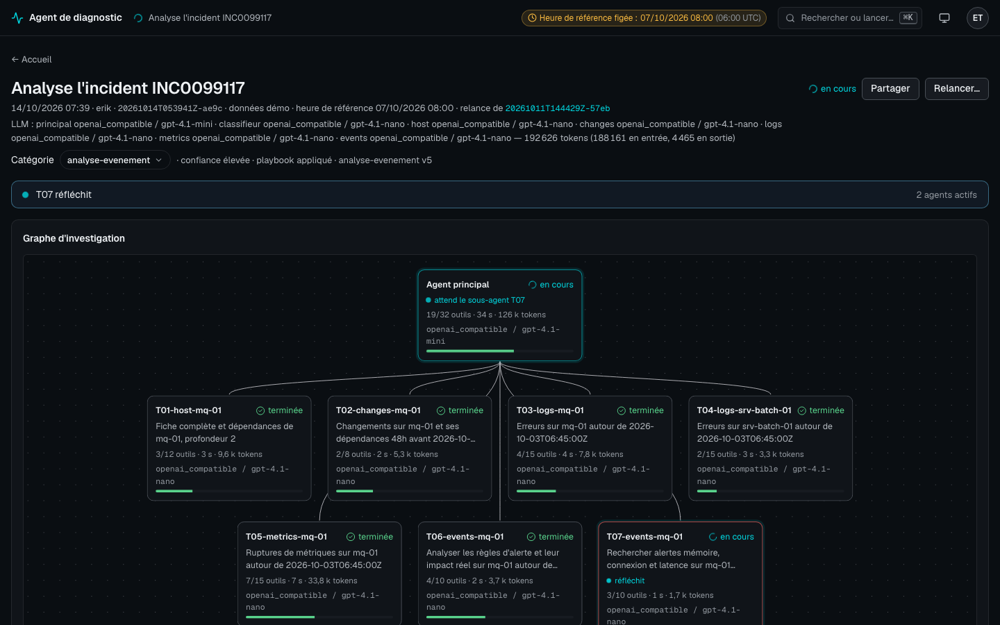

# POC de l'agent de diagnostic

Mise en œuvre progressive de l'[architecture](../docs/architecture-agent-diagnostic.md), sur des sources
de démonstration. Avancement : [suivi du POC](../docs/poc-suivi.md).

## Ce que contient le POC

| Brique | Où | Rôle |
| --- | --- | --- |
| Couche LLM agnostique | `src/diagagent/llm/` | Format pivot, adaptateurs `azure_openai`, `openai_compatible` (Ollama, vLLM) et `scripted` (tests) |
| Catalogue | `catalog/` | Une fiche YAML par source, glossaire, relations entre sources |
| Serveurs MCP | `src/diagagent/mcp_servers/` | `mcp-catalog`, `mcp-elk`, `mcp-cmdb`, `mcp-metrics`, `mcp-alerts`, `mcp-system` (SSH), en lecture seule |
| Catégorisation et playbooks | `src/diagagent/playbooks.py`, `playbooks/<catégorie>.yaml` | Classifieur, décision (playbook, combinaison, précision), stratégie de collecte par catégorie |
| Base de cas et apprentissage | `src/diagagent/knowledge.py`, `src/diagagent/learning.py` | Avis sur les diagnostics, cas confirmés, propositions d'évolution rejouées et validées par un Superviseur, indicateurs |
| Agent principal | `src/diagagent/agent.py`, `prompts/lead.md` | Boucle d'agent, budget, jeton d'annulation |
| Sous-agents | `src/diagagent/orchestrator.py`, `agents/<rôle>.yaml`, `prompts/subagent.md` | Plan, lancement en parallèle, rapports structurés, arrêt |
| Interface web | `src/diagagent/web/` | Passerelle FastAPI (connexion, rôles, flux temps réel, arrêt) et écran de suivi |
| Évaluation | `src/diagagent/evaluation.py`, `eval/`, `llm/replay.py` | Jeu de cas, contrôles automatiques, rejeu sans modèle |
| Traces | `src/diagagent/runlog.py` → `runs/` | Manifest, transcript, appels d'outils, événements, analyse |
| Données de démo | `demo_data/` | Scénario : lenteurs du service Paiement la nuit du 6 octobre 2026 |

Les serveurs MCP de démonstration lisent les fichiers de `demo_data/`. Pour brancher une vraie source,
on change le `backend` de sa fiche catalogue et le connecteur correspondant ; l'agent ne change pas.

## Installation

Python 3.11 ou plus.

```bash
cd poc
python -m venv .venv && source .venv/bin/activate
pip install -e '.[azure,dev]'
python -m pytest            # tests sans réseau ni modèle
diagagent tools             # démarre les 4 serveurs MCP et liste leurs outils
```

## Brancher le modèle

`config/models.yaml` déclare des **profils** (un modèle par rôle d'agent) et le profil par défaut
(`default: ollama`). Le profil se choisit à chaque investigation, sans toucher au fichier :

```bash
diagagent --models openai ask "…"     # ou eval, check ; DIAGAGENT_MODELS=openai fait de même
```

Dans l'interface web, un sélecteur sous la question propose les profils ; une relance (catégorie
corrigée, précision) garde le profil de l'investigation d'origine. Le profil est noté dans le manifest
(`models_profile`) et dans les résultats d'éval.

**Modèle local (profil `ollama`, défaut)** : Ollama sur `localhost:11434` avec `gpt-oss:20b` (ou vLLM,
en changeant `base_url`).

**Azure OpenAI (profil `azure`)**

```bash
export AZURE_OPENAI_ENDPOINT=https://<ressource>.openai.azure.com
az login                    # authentification Entra ID (DefaultAzureCredential)
diagagent --models azure check   # un appel court pour vérifier l'accès au déploiement gpt-5.6-luna
```

Le nom du déploiement se règle dans le profil (`deployment`). Pour une clé d'API à la place
d'Entra ID : `auth: api_key` et la variable `AZURE_OPENAI_API_KEY`.

**OpenAI (profil `openai`, POC à la maison)** : avec `OPENAI_API_KEY` dans `poc/.env`. Le profil utilise
`gpt-4.1-mini` (agent principal) et `gpt-4.1-nano` (sous-agents, classifieur) : sans raisonnement, ils
consomment bien moins de tokens que `gpt-5.4-mini`/`nano`. Ne pas indiquer `reasoning` pour ces modèles.

**Claude (POC à la maison)**

Réservé au POC sur tes propres sources : en production, les données ne partent pas chez un
fournisseur de modèle externe et l'agent reste sur Azure OpenAI.

```bash
pip install -e '.[claude]'
export ANTHROPIC_API_KEY=sk-ant-...   # clé créée sur platform.claude.com (ou `ant auth login`)
```

La clé peut aussi aller dans `poc/.env` (`ANTHROPIC_API_KEY=sk-ant-...`), ignoré par git : la commande
`diagagent` charge ce fichier au démarrage sans écraser une variable déjà exportée. PROMETHEUS_URL
et ALERTMANAGER_URL peuvent y figurer aussi.

Dans `config/models.yaml`, décommenter le profil `claude` (`provider: claude, model: claude-opus-5-5`),
puis lancer `diagagent --models claude check`.
`reasoning` règle l'effort de Claude (`low`, `medium`, `high`) ; la réflexion adaptative reste active.
Le fournisseur `claude` active aussi le cache de prompt (l'historique déjà envoyé est relu à moindre coût)
et `fallbacks: default`, qui relance sur un modèle de repli une requête refusée par un filtre de sûreté.

## Lancer une investigation

Le scénario de démonstration se joue à l'heure de référence du 7 octobre 2026, 06:00 UTC :

```bash
diagagent --now 2026-10-07T06:00:00Z ask "Pourquoi le service paiement est-il lent depuis hier soir ?"
diagagent --now 2026-10-07T06:00:00Z ask "Quels incidents sont ouverts sur srv-pay-01 ?"
```

La réponse s'affiche, et tout est tracé dans `runs/AAAA/MM/JJ/<id>/` :

```
manifest.json         question, utilisateur, modèle, statut, tokens
question.md / analysis.md
lead/system_prompt.md prompt système exact
lead/transcript.jsonl chaque requête et réponse du modèle
lead/calls/0001.json  chaque appel d'outil : entrée, sortie, durée, erreur
plan.md               plan d'investigation de l'agent principal
subagents/T01-host-srv-pay-01/
  prompt.md           prompt généré par l'agent principal
  transcript.jsonl, calls/…, report.json
events.jsonl          journal horodaté (base du futur suivi temps réel)
```

`runs/index.jsonl` liste toutes les investigations.

## Catégorisation et playbooks

Avant l'agent principal, un appel au modèle séparé (le classifieur) range la demande dans une des
catégories de `playbooks/` : `information`, `indisponibilite`, `performance`, `analyse-evenement`,
`impact-change`, `tendance` ou `autre`. Il reçoit la description et les exemples de chaque catégorie
active et rend la catégorie, sa confiance, une éventuelle deuxième catégorie, les entités repérées et
les entités indispensables qui manquent.

| Classification | Ce qui se passe |
| --- | --- |
| Une catégorie | Son playbook est injecté dans le prompt de l'agent principal comme plan de départ |
| Deux catégories plausibles (confiance moyenne ou faible) | Les deux playbooks sont injectés ; l'agent commence par les étapes communes puis tranche |
| Entité indispensable manquante (« mon site » sans dire lequel) | L'investigation s'arrête au statut `needs_clarification` avec la question à poser ; l'interface propose de préciser et relancer |
| Aucune catégorie, ou classifieur indisponible ou illisible | Catégorie `autre`, stratégie générique |

Le modèle oublie parfois une entité écrite dans la demande. Avant de poser une question de précision,
l'orchestrateur relit la demande : un numéro `INC` ou `CHG`, ou le nom exact d'une alerte connue
(en cours dans Alertmanager ou règle d'alerte de Prometheus), complète l'entité manquante (événement
`entities_completed`). Une demande classée `autre` qui nomme une alerte connue passe en
`analyse-evenement`, avec une confiance faible.

Une **portée globale** (« le SI », « le système d'information », « la prod », « l'infra » : section
`scopes` de `catalog/glossary.yaml`) n'est ni un service ni un host : l'entité devient `scope: global`,
aucune précision n'est demandée (événement `global_scope`), `resolve_entity` rend `scope: global` et
l'agent principal fait un état global (étape `etat-global` du playbook `information`). Pour une panne (« la prod est en panne », playbook `indisponibilite`), il cherche d'abord tout ce qui ne fonctionne pas ou a mal fonctionné dans la dernière heure (étape `panne-globale` : alertes, cibles injoignables, incidents, logs en erreur, changements), puis creuse chaque service ou host touché. Ces étapes portent `scope: global` et n'apparaissent dans le playbook que pour une portée globale. Dans une phrase,
« SI » n'est reconnu qu'en majuscules : « que faire si le disque est plein » n'est pas une portée.

En cours de route, l'agent principal peut appeler `requalify` si les faits contredisent la catégorie ;
le changement est tracé (`category_changed` dans `events.jsonl`). La catégorie, sa confiance et la
version des playbooks appliqués sont dans `manifest.json` (clé `category`) et dans `runs/index.jsonl`.

Avant d'accepter la réponse finale, l'orchestrateur la contrôle et relance l'agent principal, une fois
par motif (événement `final_answer_rechecked`) :
- **vagues non lancées** : une étape du playbook prévoit des sous-agents et aucun de ses rôles n'a été
  lancé (`gpt-oss:20b` fait souvent tout lui-même, ou ne lance que `generic`). L'agent lance les
  étapes manquantes ou dit dans les Limites pourquoi il les saute. Le rôle `generic` et les rôles
  indisponibles ne comptent pas ; après `requalify`, c'est le nouveau playbook qui compte ;
- **actions non enregistrées** : la réponse décrit des actions sans avoir appelé `propose_action` ;
- **tailles contraires aux mesures** (`facts_unsupported`) : la réponse dit qu'un conteneur « dépasse
  1 Go » alors que le plus haut de ses mesures dans l'investigation (`container_memory`, cache compris,
  ou `container_metrics`) est plus bas.

`propose_action` contrôle aussi l'action avant de l'enregistrer (`src/diagagent/checks.py`). En cas de
refus, l'erreur revient au modèle (événement `action_rejected`), qui corrige l'action :
- une **limite mémoire** (`--memory`, `mem_limit`, `memory:` ou « limite … 1 Go ») doit dépasser le pic
  de mémoire de travail du conteneur (`container_metrics`, `container.mem_mb`) d'au moins
  `memory_limit_margin_pct` (20 % par défaut, `config/poc.yaml`). Sans cette mesure, l'agent doit
  d'abord la faire. `peak_mb` de `container_memory` ne compte pas, car il inclut le cache de fichiers :
  qbittorrent y affiche 8,5 Go pour 381 Mo de mémoire de travail ;
- une **règle d'alerte** (`expr:` dans la procédure ; si la règle actuelle est citée avant, seule la
  dernière expression est contrôlée) doit être acceptée par Prometheus, et chacune de
  ses métriques doit avoir des séries. Elle ne doit pas recopier une règle existante : la même règle à
  l'identique ne règle rien, et une même expression sous un autre nom fait une alerte en double.
  Prometheus absent ou injoignable : ce contrôle est sauté (`action_check_skipped`).

Les vagues sont aussi rappelées **en cours de route**, une fois (événement `progress_reminder`) : après
`early_wave_reminder` appels directs aux sources (8 par défaut, `config/poc.yaml`) sans aucun sous-agent
spécialisé. Rappelé seulement à la fin, l'agent principal a souvent déjà épuisé son budget et manque la
dernière vague (remédiation, sous-agent web).

```bash
diagagent playbooks                               # valide et liste les playbooks
diagagent ask --category performance "…"          # impose la catégorie, sans classifieur
```

Le classifieur utilise le rôle `classifier` du profil de modèles ; absent, il prend le modèle de
`subagent`. Dans l'interface, la catégorie s'affiche sous la question ; l'auteur ou un administrateur
peut la corriger, ou relancer avec une autre catégorie. Chaque correction est ajoutée à
`runs/feedback/categories.jsonl`, qui servira à l'apprentissage (étape 7). L'historique se filtre par
catégorie.

## Base de cas et apprentissage

L'agent ne modifie jamais seul ses catégories ni ses playbooks : il propose, un Superviseur valide.

**Ce qui alimente l'apprentissage**

- Les corrections de catégorie faites dans l'interface (`runs/feedback/categories.jsonl`).
- L'avis sur chaque diagnostic, donné sous la réponse : utile, partiel ou faux, avec la cause réelle
  si on la connaît (`runs/feedback/diagnostics.jsonl`).
- Les cas confirmés : un diagnostic jugé utile, avec sa cause, peut être enregistré comme cas
  (case à cocher dans l'interface, ou `diagagent case add <run_id> --cause "…"`). Le cas va dans
  `knowledge/cases/<run_id>.yaml` et dans l'index `knowledge/index.jsonl`.

**Ce qui s'en sert tout de suite**

- Le classifieur reçoit les demandes passées les plus proches dont la catégorie est confirmée.
- L'agent principal reçoit les cas déjà vus proches de la demande (mots et entités en commun), à
  vérifier, jamais à recopier sans preuve.

**Agent d'apprentissage**

```bash
diagagent learn                     # analyse les 7 derniers jours, écrit playbooks/proposals/*.yaml
diagagent learn --no-model          # propositions mécaniques seulement
diagagent proposals                 # liste, avec le résultat du rejeu
diagagent proposals accept <id> --by sophie --comment "…"
diagagent playbooks --rollback performance   # revient à la version précédente (history/)
```

| Proposition | D'où elle vient |
| --- | --- |
| Ajout d'exemples à une catégorie | Corrections de catégorie (mécanique) |
| Activation d'une catégorie en observation | Au moins 3 demandes qu'elle aurait captées (mécanique) |
| Nouvelle catégorie, en observation (`draft`) | Demandes classées `autre` ou avec une confiance faible (modèle) |
| Ajout d'hypothèses à un playbook | Cas confirmés dont la cause n'est pas parmi les hypothèses (modèle) |
| Nouvelle description | Confusions récurrentes entre deux catégories (modèle) |

Chaque proposition est rejouée : le classifieur reclasse les demandes de référence (cas de
`eval/cases.yaml` avec une catégorie, demandes confirmées) avec les playbooks actuels puis avec la
proposition. Une proposition qui fait baisser la justesse est écartée (`discarded`). La justesse des
diagnostics n'est pas rejouée dans le POC, car il faudrait une investigation complète par demande.

Un Superviseur accepte ou rejette chaque proposition dans l'écran **Amélioration continue** de
l'interface. L'Administrateur y voit les indicateurs et les propositions, sans pouvoir valider. Une
proposition acceptée écrit la nouvelle version du playbook, garde l'ancienne dans
`playbooks/history/` et trace la décision dans `playbooks/proposals/decisions.jsonl`. Une nouvelle
catégorie démarre en `draft` : le classifieur la voit, mais une demande qui y correspond suit la
deuxième catégorie, ou `autre`. La correspondance est notée (`draft_match`) pour mesurer ce que la
catégorie aurait capté.

L'écran donne aussi, par catégorie : la part des demandes, la part classée `autre`, la part
corrigée, la part de diagnostics jugés justes, la durée et le nombre d'appels d'outils moyens.

## Sous-agents

Pour un diagnostic, l'agent principal écrit `plan.md`, lance un sous-agent par investigation
(`spawn_subagent`), en parallèle, puis attend leurs rapports (`wait_subagents`). Chaque rôle est décrit
dans `agents/<rôle>.yaml` : prompt, serveurs MCP autorisés, budget. Un rôle sans source disponible
n'est pas proposé (en mode maison, `logs` et `changes` disparaissent faute d'ELK). Le modèle des
sous-agents se règle par la clé `subagent` du profil de modèles, ou par rôle.

## Interface web

```bash
diagagent user add erik --role administrateur --name Erik     # demande le mot de passe (12 caractères min.)
diagagent user add sophie --role superviseur --name Sophie    # valide les propositions d'évolution
diagagent serve                                               # http://127.0.0.1:8080
diagagent --now 2026-10-07T06:00:00Z serve                    # scénario de démonstration (voir ci-dessous)
```

Les recherches sans période portent sur les 24 h qui précèdent l'**heure de référence**. Lancé sans
`--now`, le serveur utilise l'heure réelle : les données de démonstration (nuit du 6 octobre 2026) sont
alors hors période, et l'agent doit élargir lui-même ses recherches. Pour jouer le scénario comme
`diagagent eval`, lancer le serveur avec `--now 2026-10-07T06:00:00Z` ; l'heure figée s'affiche dans la
barre du haut, et l'heure de référence de chaque investigation sous sa question.

- **Accueil** : la question en grand (`Entrée` lance, `Maj+Entrée` passe à la ligne), avec en puces le
  choix du **modèle** (profils de `config/models.yaml`), des **données** (démo, maison ou les deux) et de
  la **catégorie** (automatique par défaut ; une catégorie imposée choisit le playbook sans passer par le
  classifieur). Une option indisponible reste visible, grisée, avec la raison ; le navigateur retient le
  dernier choix, sinon le défaut du serveur (`DIAGAGENT_MODELS`, `DIAGAGENT_SOURCES` dans `.env`). Champ
  vide : suggestions (alertes en cours, tes dernières questions, exemples des playbooks). Dessous : les
  investigations **en cours** en cartes (mini-graphe des agents, ligne de statut, relues toutes les
  3 s), puis l'**historique filtrable** : période, utilisateur (rôles qui voient tout), catégorie, statut,
  host et texte de la question, filtres combinables gardés dans l'adresse (`#?periode=7j&statut=partial`,
  partageable) et appliqués par l'API (`GET /api/runs?since=…&until=…&user=…&category=…&status=…&host=…&q=…`).
  À droite : **état** des modèles et des sources (Ollama interrogé, clés présentes, cibles Prometheus up ;
  aucun appel payant), alertes Alertmanager en cours (« Investiguer » préremplit la question) et chiffres
  du jour. **Statistiques et évaluations** sont repliées en bas : dernier résultat d'éval par modèle,
  réussite sur 1, 7 ou 30 jours par catégorie, par agent et par modèle, évaluations exclues sauf demande.
  Le détail d'une investigation s'ouvre au clic (`#<run_id>`, partageable). Un Lecteur voit les
  investigations partagées, sans zone de question.
- **Palette de commandes** (`Ctrl+K` ou `⌘K`, partout, ou le bouton de la barre du haut) : poser une
  question (le texte tapé devient la question), ouvrir une investigation récente, investiguer une alerte,
  relancer l'investigation affichée, aller à l'administration, changer de thème, se déconnecter.
  Raccourcis : `/` va à la question, `g h` à l'accueil, `g a` à l'administration, `?` ouvre la palette.
- **Relancer…** (sur une investigation) : prépare une nouvelle demande sur l'accueil, préremplie avec la
  question, le modèle, les données et la catégorie imposée ou corrigée de l'investigation d'origine, **sans
  la lancer** : on change la question ou les options, puis « Lancer l'investigation ». La nouvelle
  investigation note `rerun_of` dans son manifest et affiche un lien vers l'originale ; les relances
  « Relancer avec cette catégorie » et « Préciser et relancer » le notent aussi.

Pour l'ouvrir depuis une autre machine du réseau : `diagagent serve --host 0.0.0.0`, et définir
`DIAGAGENT_SESSION_SECRET` pour que les sessions survivent à un redémarrage.

- **Conversation** : on pose la question sur l'accueil ; la réponse de l'agent principal **s'affiche
  pendant qu'il l'écrit** (événements `answer_delta`, adaptateurs OpenAI compatible et Azure ; `stream:
  false` dans le fournisseur de `config/models.yaml` pour la couper, et repli automatique sur une réponse
  en bloc si le serveur refuse la diffusion ; l'adaptateur Claude affiche encore la réponse en bloc). Un
  texte suivi d'appels d'outils n'était qu'un préambule et disparaît ; si un contrôle de l'orchestrateur
  relance l'agent, la réponse est marquée « en cours de révision ».
- **Réponse** : à la fin, la synthèse en premier, en grand, avec le niveau de confiance de la cause
  probable (« Confiance : élevée », demandé par le prompt), puis chronologie, cause, pistes et limites ;
  une investigation terminée affiche sa réponse en haut de la page. Chaque preuve `[…/calls/NNNN.json]`
  est une puce (« T02 · appel 6 ») qui ouvre l'appel exact et, au survol, éclaire l'agent dans le graphe
  et la chronologie.
- **Actions proposées** : risque, « jamais exécutée par l'agent » sur chaque carte, preuves, procédure et
  retour arrière avec un bouton de copie, validation par un Superviseur. La catégorie se corrige dans un
  popover (enregistrer, ou relancer avec la nouvelle catégorie).
- **Ligne de statut** (en direct) : ce que fait l'agent actif le plus récent, en clair (« T03 interroge
  les métriques : cpu.usage de srv-pay-01 »), et le nombre d'agents actifs ; le titre de l'investigation
  et son état restent dans la barre du haut.
- **Graphe d'investigation** : agent principal et sous-agents, colorés par état, avec l'action en cours,
  la jauge de budget et les signaux. En direct, un agent qui naît apparaît en fondu et chaque appel
  d'outil envoie une impulsion le long de son lien ; le graphe se recadre quand un agent arrive.
- **Signaux** : calculés par l'orchestrateur (`src/diagagent/signals.py`) et écrits dans `events.jsonl`
  (`signal_raised`, `signal_cleared`), donc visibles au rejeu : bloqué (aucun événement depuis 120 s ;
  l'agent principal qui attend des sous-agents actifs ne l'est pas), boucle (même appel 3 fois),
  3 erreurs d'outil de suite, budget au-delà de 80 %, modèle (refus, quota, bascule de secours), source
  lente (appel d'outil au-delà de 10 s, marqué dans la chronologie). Seuils dans `config/poc.yaml`
  (section `signals`). Les traces antérieures gardent les signaux recalculés par le navigateur.
- **Chronologie** : une ligne par agent, appels au modèle et aux outils ; les appels encore ouverts
  s'étirent en direct, l'attente des sous-agents est hachurée, une source lente soulignée. Le survol d'une
  ligne éclaire le nœud du graphe, et inversement.
- **Fil d'activité** : chaque appel d'outil, lancement, rapport, signal et décision, du plus récent au
  plus ancien ; un clic sur l'agent ouvre son détail.
- **Modèles et tokens** : sous la question, le fournisseur et le modèle de chaque rôle (principal,
  classifieur, sous-agents) et les tokens consommés, comptés en direct ; sur chaque nœud et dans le
  détail d'un agent, son modèle et ses tokens. Ils sont aussi dans `manifest.json` (`models`,
  `usage`, `usage_by_agent`).
- **Détail d'un agent** (clic sur un nœud) : prompt reçu, rapport, chaque appel d'outil, réponses du modèle,
  bouton d'arrêt.
- **Arrêt** : un sous-agent arrêté rend un rapport partiel et l'agent principal continue ;
  « Arrêter l'investigation » demande à l'agent principal une synthèse partielle. **Arrêt immédiat**
  (permission `kill`, Superviseur et Administrateur) coupe tout sans synthèse, après confirmation.
- **Piloter en cours de route** (droits de l'arrêt : l'auteur, ou qui voit tout) :
  - **consigne** à l'agent principal, depuis le champ sous la ligne de statut (`POST
    /api/runs/{id}/instructions`) : remise avant son prochain appel au modèle (`instruction_received`, puis
    `instruction_delivered`) ;
  - **relance d'un sous-agent** terminé ou arrêté, depuis son tiroir, avec son prompt d'origine ou corrigé
    (`POST /api/runs/{id}/agents/{agent}/restart`) : un nouveau sous-agent (`T08-…`, `restart_of` dans
    `agent_spawned`) dont le rapport est remis à l'agent principal ;
  - **budget** d'un agent en cours (permission `adjust_budget`, Superviseur et Administrateur), depuis la
    jauge du tiroir : +5, +10 ou un plafond (`POST /api/runs/{id}/agents/{agent}/budget`,
    `budget_changed`), pris en compte au prochain tour. Chaque sous-agent a désormais son propre budget.

  Les trois commandes sont tracées dans `events.jsonl` et dans le journal d'accès.
- **Démonstration en direct sans modèle** : `uv run python tools/demo_live.py <run_id> --speed 2` rejoue
  une investigation enregistrée sous un nouvel identifiant, au rythme d'origine, signaux recalculés ;
  ouvrir l'adresse affichée (le serveur doit lire le même dossier `runs/`).

Les cinq rôles du document d'architecture :

| Rôle | Ce qu'il peut faire |
| --- | --- |
| `lecteur` | Lire les investigations partagées, avec graphe et chronologie, sans prompts ni appels d'outils |
| `operateur` | Poser des questions ; voir en détail, arrêter, partager, corriger et noter les siennes |
| `superviseur` | Comme l'opérateur, sur toutes les investigations ; arrêt immédiat ; valider ou rejeter les actions proposées et les évolutions de playbooks ; modifier playbooks, prompts et jeu d'évaluation ; indicateurs et coûts |
| `administrateur` | Tout voir et tout arrêter ; gérer les comptes ; modifier catalogue, modèles, paramètres et rôles de sous-agents ; indicateurs, coûts et journal d'accès ; ne valide pas |
| `auditeur` | Tout lire, prompts, configuration et journal d'accès compris, sans rien piloter |

Une investigation partagée (bouton **Partager**) devient lisible par tout utilisateur connecté, mais
seuls son auteur et les rôles qui voient tout en ont le détail. L'écran **Administration** regroupe,
selon le rôle : les actions à valider, les indicateurs par catégorie, les propositions d'évolution, les
coûts (tokens par jour, utilisateur et modèle ; le POC n'a pas de notion d'équipe, un Superviseur voit
tout) et le journal d'accès. Comptes dans `auth/users.yaml` (mots de passe en Argon2id, verrouillage
15 min après 5 échecs) ; journal d'accès dans `audit/`.

### Développer l'interface

L'interface est écrite en TypeScript et React (graphe d'agents avec React Flow) dans `poc/web-ui/` ; sa
refonte suit le [plan de l'interface](../docs/plan-interface.md). Le thème suit le réglage du système
(sombre ou clair), avec une bascule dans la barre du haut.

Le code compilé (`src/diagagent/web/static/dist/`) est versionné : le POC s'installe et se lance sans
Node. Pour modifier l'interface (Node 24 ou plus) :

```bash
cd poc/web-ui && npm ci
npm run dev        # http://127.0.0.1:5173/static/dist/ ; l'API vient de « diagagent serve » (port 8080)
npm run check      # types, lint, tests
npm run build      # met à jour static/dist, à commiter avec les sources (la CI le vérifie)
```

### Modifier la configuration depuis l'interface

La section **Configuration** de l'écran Administration ouvre chaque fichier qui règle l'agent dans
un éditeur. Le Superviseur modifie le contenu du diagnostic, l'Administrateur la plateforme ; les deux,
et l'Auditeur, lisent tout et l'historique.

| Fichiers | Modifiés par |
| --- | --- |
| `catalog/sources/*.yaml`, `catalog/glossary.yaml`, `catalog/relations.yaml`, `config/models.yaml`, `config/poc.yaml`, `agents/*.yaml` | Administrateur |
| `playbooks/*.yaml`, `prompts/*.md`, `eval/cases*.yaml` | Superviseur |

- **Vérifier** relit le contenu avec les règles de l'orchestrateur, sans rien écrire : syntaxe YAML,
  champs obligatoires, `id` (ou `role`) égal au nom du fichier, rôles et fournisseurs connus, budgets
  positifs, variables d'un prompt (`{now}`, `{catalog}`… ; une accolade littérale s'écrit `{{`).
- **Enregistrer** demande un commentaire et refuse un fichier invalide, ou modifié par quelqu'un d'autre
  depuis son ouverture (409). L'écriture est atomique. Chaque version est gardée dans `config-history/`
  avec son auteur, son commentaire et son empreinte (la version d'origine au premier enregistrement), et
  une entrée `config_changed` va dans le journal d'accès.
- **Historique** : l'écart d'une version avec le fichier actuel, et **Reprendre cette version** pour
  revenir en arrière (c'est un nouvel enregistrement, tracé).
- **Nouveau fichier** : une fiche de source, un rôle de sous-agent, un playbook ou un jeu de cas.
  Les prompts et les fichiers de la plateforme ne se créent pas.

Une modification vaut pour les investigations lancées ensuite. Après un changement de playbook ou de
prompt, rejouer le jeu d'évaluation (`diagagent eval`) dit s'il a fait régresser le diagnostic.

La section **Comptes** (Administrateur) crée un compte, change ses rôles, le désactive ou lui donne un
nouveau mot de passe ; `auth/users.yaml` ne s'édite jamais en texte, et les empreintes de mot de passe
ne sortent pas de la passerelle. Le dernier administrateur actif ne peut être ni retiré ni désactivé.
Restent hors de l'interface : le code, `.env` et les secrets, `runs/`, `audit/` et `knowledge/`.



## Actions proposées

L'agent principal enregistre chaque action qu'il recommande avec `propose_action` : type (diagnostic
complémentaire, remédiation, contournement, ouverture de ticket), cible, justification et preuves,
risque, procédure, retour arrière, passage ou non par la gestion des changements. Elles sont écrites
dans `actions.json` et affichées dans l'interface ; aucun outil ne permet de les exécuter.

Un Superviseur valide ou rejette chaque action, depuis l'investigation ou depuis la liste des actions
en attente de l'écran Administration. La décision (qui, quand, commentaire) est écrite dans
`actions.json` et dans le journal d'accès. Une action validée reste non exécutée : l'exécution avec
validation humaine fera l'objet d'un document séparé.

## Évaluation et rejeu

```bash
diagagent eval                                   # joue eval/cases.yaml avec le modèle configuré
diagagent eval --only diag-paiement              # un seul cas
diagagent eval --repeat 3                        # chaque cas 3 fois : taux de réussite par cas
diagagent eval --kind simple                     # seulement les 20 questions simples (ou --kind incident)
diagagent replay 20261008T061159Z-5f31           # rejoue une investigation sans appeler le modèle
```

`eval` pose chaque question du jeu de cas et vérifie la réponse : catégorie rendue par le classifieur,
mentions attendues ou interdites, nombre de sous-agents, actions proposées, erreurs d'outil. Le résumé
donne aussi la justesse de catégorisation. Le rapport va dans `eval/results/`.
Les cas sont rangés en deux familles, comptées à part pour les critères de sortie du document
d'architecture : 20 questions `simple` (critère : toutes justes) et 20 `incident` (critère : cause
correcte sur une majorité). Une mention attendue peut être une liste d'écritures possibles
(`[["3897", "3 898"]]`), et la comparaison ignore les traits d'union et espaces insécables.

Les 17 incidents passés ajoutés au scénario de démonstration (`demo_data/scenarios.py`, du 15 septembre
au 3 octobre) ont chacun une cause connue : disque plein, certificat expiré, fuite mémoire après
déploiement, DNS arrêté, verrous d'une sauvegarde, alarme mémoire RabbitMQ, mot de passe changé, réseau
NFS, robot, index supprimé, OOM, horloge, traces DEBUG, contrôle de santé, inodes, port erroné,
consommateur arrêté. Chaque cas est rejoué à son heure de référence (`now`, 30 minutes après le début du
symptôme) et les sources de démonstration répondent telles qu'elles étaient alors : rien d'horodaté après,
ticket encore « In Progress » sans sa résolution, alertes encore ouvertes (`as_of` des fiches
`incidents` et `events`). `python demo_data/generate.py` régénère ces données.

`eval/cases.yaml` porte sur le scénario de démonstration ; `eval/cases-maison.example.yaml` sert de
modèle pour des questions sur tes propres sources. `diagagent --models <profil> eval` compare les
modèles sur les mêmes questions ; le rapport donne la durée totale et le profil utilisé. Avec un modèle local, les résultats varient
d'un passage à l'autre (le même code a donné 7 puis 4 cas réussis sur 9 avec `gpt-oss:20b`) : comparer
avec `--repeat` plutôt que sur un seul passage.

`replay` refait passer les décisions enregistrées du modèle dans les outils actuels et signale chaque
appel d'outil dont le résultat a changé : utile après une modification d'un serveur MCP ou du catalogue. La
catégorie d'origine est imposée : le classifieur n'est pas rejoué.

## Brancher Prometheus et Alertmanager

Deux variables suffisent, de préférence dans `poc/.env` :

```bash
PROMETHEUS_URL=http://192.168.1.15:9090
ALERTMANAGER_URL=http://192.168.1.15:9093
```

Les sources forment deux jeux : `demo` (données factices de `demo_data/`) et `maison` (Prometheus,
Alertmanager, actives seulement si leur variable est définie). Par défaut les deux sont actifs ; le
choix se fait par investigation, sans toucher à `.env` :

```bash
diagagent tools                                  # doit lister list_hosts, promql, list_alerts, alert_history…
diagagent ask "Pourquoi le NAS était-il lent cette nuit ?"           # démo + maison
diagagent --sources maison ask "Quelles machines sont suivies ?"     # seulement les sources réelles
diagagent --sources demo ask "…"                                     # seulement la démo
```

Dans l'interface web, le sélecteur « Données » (affiché dès qu'une source réelle est configurée)
propose les trois choix ; le manifest note les jeux utilisés (`sources`). Les tests `pytest` et le
banc `eval/cases.yaml` (`sources: demo`) n'utilisent que la démo, même si `PROMETHEUS_URL` est
définie : ils restent reproductibles. Les données de démo sont datées autour du 7 octobre 2026
(`--now`) : en mode mixte à l'heure réelle, elles sortent de la fenêtre par défaut de 24 h.

Sans `--now`, l'heure de référence est l'heure réelle. Ce que l'agent obtient :

| Outil | Source | Contenu |
| --- | --- | --- |
| `list_hosts` | Prometheus (`up`) | Machines suivies, job, cible joignable ou non |
| `list_metrics`, `query_metric` | Prometheus | Métriques normalisées (CPU, charge, mémoire, disque, réseau) résumées avec ruptures |
| `promql` | Prometheus | Requête libre, résumée par série |
| `list_alerts`, `list_silences` | Alertmanager | Alertes actives, silences en cours |
| `alert_history` | Prometheus (`ALERTS`) | Alertes passées et leurs intervalles de déclenchement |
| `container_metrics` | Prometheus (cAdvisor) | Mémoire, swap, CPU ou OOM par conteneur Docker, classés par pic, avec l'heure du pic |
| `container_changes` | Prometheus (cAdvisor) | Conteneurs démarrés, redémarrés ou mis à jour sur la période, version avant et après |
| `alert_rule` | Prometheus (règles) | Expression, seuil, durée et hosts en alerte d'une règle : l'alerte mesure-t-elle un impact ? |

Les métriques normalisées sont des modèles PromQL dans `catalog/sources/metrics-prometheus.yaml`,
écrits pour node_exporter ; on les adapte ou on en ajoute selon les exporters installés. Le nom de
host est le label `instance` sans le port (réglable par `host_label`). Un jeton facultatif se passe
par `PROMETHEUS_TOKEN` ou `ALERTMANAGER_TOKEN`.

## Interroger les machines en direct (SSH)

Prometheus dit quand la mémoire a manqué, pas quel processus l'a prise. `mcp-system` se connecte aux
machines en SSH, en lecture seule, et exécute une seule chose : le script `remote/diagagent-probe`,
avec une sonde fixe (`memory`, `processes`, `containers`, `oom`). Le modèle ne choisit que le host,
parmi ceux de `SSH_HOSTS` ; il n'écrit jamais de commande.

```bash
SSH_HOSTS=xdocker,pdocker,traefik    # séparés par des virgules, sans guillemets ; xdocker=192.168.1.20 si besoin
SSH_USER=diagagent                   # facultatif, sinon ~/.ssh/config
SSH_KEY=~/.ssh/diagagent_ed25519     # facultatif
```

`SSH_HOSTS` est une liste séparée par des virgules (les espaces autour des noms sont ignorés). Chaque
nom est celui du host dans Prometheus (label `instance` sans le port), pour que le sous-agent `system`
relie l'état en direct aux métriques. Quand ce nom ne se résout pas en SSH, on ajoute l'adresse après
`=` : `xdocker=192.168.1.20`. Chaque machine doit accepter la connexion sans mot de passe
(`BatchMode=yes`) et avoir sa clé d'hôte déjà dans `known_hosts` (`StrictHostKeyChecking=yes`). Rien
n'est à installer : le script `remote/diagagent-probe` part sur l'entrée standard. Pour vérifier une
machine : `ssh <host> sh -s -- memory < remote/diagagent-probe`.

| Outil | Contenu |
| --- | --- |
| `list_ssh_hosts` | Machines joignables |
| `host_memory` | RAM disponible, swap, pression mémoire (PSI), swappiness |
| `top_processes` | Processus par RAM ou par swap, avec leur conteneur Docker |
| `container_memory` | Mémoire, swap, pic depuis le démarrage (`memory.peak`) et limite de chaque conteneur |
| `oom_events` | Messages OOM du noyau des 7 derniers jours |

Les réponses décrivent l'état au moment de l'appel (`observed_at`), pas à l'heure de référence :
le sous-agent `system` les croise avec les métriques pour un pic passé. Le rôle n'est proposé que
si `SSH_HOSTS` est définie ; les playbooks `analyse-evenement` et `performance` l'appellent.

Le script part sur l'entrée standard (`sh -s -- <sonde>`) : rien à installer, mais le compte SSH peut
alors tout faire. Pour que la clé ne permette que ces lectures, sur chaque machine :

```bash
useradd -r -m -s /bin/sh diagagent
install -m 755 diagagent-probe /usr/local/bin/diagagent-probe
# ~diagagent/.ssh/authorized_keys :
command="/usr/local/bin/diagagent-probe",restrict ssh-ed25519 AAAA... diagagent
```

La machine exécute alors son propre script, avec le dernier mot de la commande reçue comme nom de
sonde ; toute autre demande est refusée. Le compte n'a pas besoin de root : `/proc` donne le swap de
chaque processus. Pour les noms des conteneurs, l'ajouter au groupe `docker` (équivalent à root, mais la
commande forcée borne ce que la clé lance ; sans ce groupe, les identifiants
seuls) ; pour `oom_events`, au groupe `systemd-journal` ou `adm`. La clé d'hôte doit déjà être dans
`known_hosts` (`StrictHostKeyChecking=yes`) : se connecter une fois à la main.

## Recherche web et pistes de remédiation

Une cause trouvée ne suffit pas : « augmenter la RAM » n'aide personne. Une fois la cause établie,
l'agent principal examine quatre pistes et dit pour chacune ce qu'il retient ou écarte
(rubrique « Pistes de remédiation » de la réponse, étape `remediation` des playbooks
`analyse-evenement` et `performance`) :

1. **Impact réel** : le sous-agent `events` lit la règle de l'alerte (`alert_rule`) et la compare aux
   signes d'impact (pression mémoire, swap relu, erreurs, latence). Une alerte permanente sans impact
   est un faux positif : l'action proposée est de type `réglage de supervision`, avec la nouvelle règle.
2. **Problème connu** : le sous-agent `web` cherche le logiciel, sa version (`container_memory` lit le
   label `org.opencontainers.image.version` de l'image) et le symptôme sur les forums et issues.
3. **Réglage de l'application** : paramètre exact, valeur et endroit, d'après les sources.
4. **Réglage du système** : swappiness, taille du swap, limite mémoire du conteneur, RAM.

Une action donne le paramètre exact et sa valeur, et cite l'URL d'une source web. Une limite mémoire
n'est jamais sous le pic déjà mesuré, et une alerte existante se règle au lieu d'être recréée.

```bash
WEB_SEARCH=duckduckgo                 # sans clé ; ou l'URL d'une instance SearXNG (API JSON)
WEB_SEARCH_DENY=beauvalot,maison      # facultatif : mots jamais envoyés au moteur
```

| Outil | Contenu |
| --- | --- |
| `web_search` | Titre, URL et extrait des résultats (10 au plus, sans annonces) |
| `web_page` | Texte lisible d'une page publique (8000 caractères, sans menus ni scripts) |

Garde-fous : une requête qui contient une adresse IP, un nom de `SSH_HOSTS` ou un mot de
`WEB_SEARCH_DENY` est refusée avant l'envoi. `web_page` ne lit que des adresses publiques, redirections
comprises : pas d'accès au réseau local ni à `localhost`. Le contenu des pages est une donnée, jamais
une instruction. Réservé au POC à la maison : en production, les requêtes ne sortent pas sur internet.

## Régénérer les données de démonstration

```bash
python demo_data/generate.py
```
